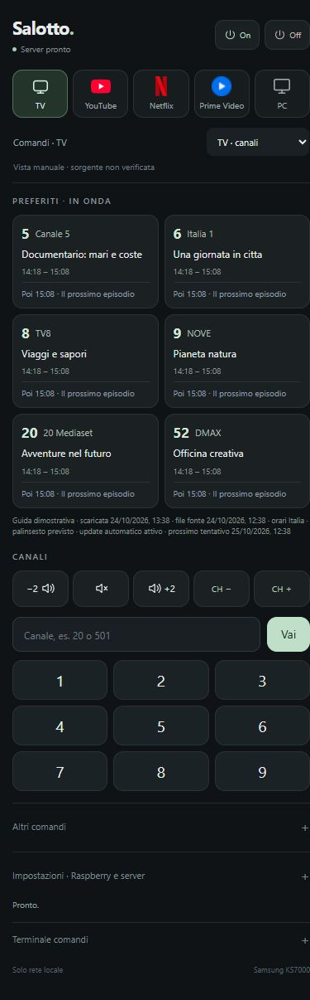
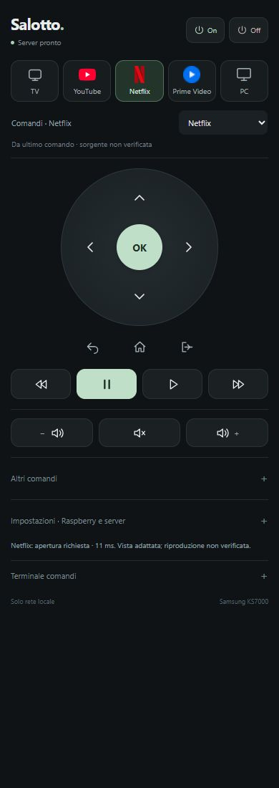
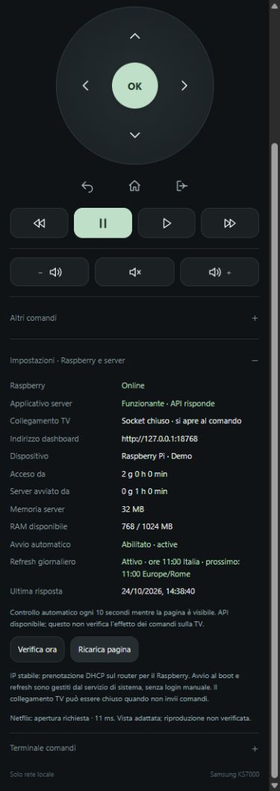

# Smart TV Remote

A compact, local web remote for Samsung Tizen TVs. Run the Python server on a
Raspberry Pi or computer, then control your TV from a phone on the same network.
The interface is in Italian and is designed for narrow mobile screens.

## Interface

These screenshots use simulated devices and example schedules. They contain no
real device identifiers, credentials, household addresses or diagnostic logs.

<p>
  
  
</p>

<details>
<summary>Device and server status</summary>



</details>

## Features

- TV antenna, YouTube, Netflix, Prime Video and PC on HDMI 1.
- Favorites with current and next programmes, channel keypad and direct entry.
- Volume in two-step increments, mute and previous/next channel on one row.
- Directional navigation and playback controls in streaming views.
- Wake-on-LAN and a short Power press for standby.
- Device/server status, uptime, memory and systemd service/timer status.
- External XMLTV guide refreshed every 24 hours without opening the browser;
  failed downloads retry after 6 hours while keeping the last valid cache.
- A command timeline with request IDs and timing, plus rotating diagnostic logs.
- Optional systemd startup at boot and daily server refresh at 11:00 Europe/Rome.

## Requirements and compatibility

Python 3.10 or newer, a Samsung TV with network remote support, and a trusted
local network. The original deployment used a Samsung UE49KS7000 (2016) and a
Raspberry Pi 3 B. Other models may differ in supported keys, app IDs, wake behavior
and source switching. HDMI 1 selection is implemented but still needs visual
confirmation on the target TV. A successful send is not a TV execution ACK.

## Run locally

Create a virtual environment and install the single application dependency:

```sh
python -m venv .venv
# Linux / Raspberry Pi
.venv/bin/python -m pip install -r requirements.txt
# Windows
.venv\Scripts\python.exe -m pip install -r requirements.txt
```

Set `TV_HOST` to **your TV's LAN address**. The address below is a documentation
example; replace it. There is no household IP or password built into the project.

Linux / Raspberry Pi:

```sh
export TV_HOST=198.51.100.20
.venv/bin/python server.py
```

Windows PowerShell:

```powershell
$env:TV_HOST = '198.51.100.20'
.\.venv\Scripts\python.exe server.py
```

Open [localhost:8765](http://127.0.0.1:8765) on the server computer. On a phone,
open `http://SERVER_LAN_IP:8765` on the same network. Allow the new remote on the
TV when prompted. The server prints its available local addresses at startup.

| Setting | Default | Purpose |
|---|---|---|
| `TV_HOST` | `127.0.0.1` | Set this to your TV's LAN address before controlling it |
| `TV_PORT` | `8002` | Samsung WebSocket port |
| `TV_CLIENT_NAME` | `Smart TV Locale` | Name displayed in the TV authorization prompt |
| `--bind` | `0.0.0.0` | HTTP bind address; use `127.0.0.1` for computer-only access |
| `--port` | `8765` | Dashboard port |

[.env.example](.env.example) documents the variables; `.env` files are **not**
automatically loaded. Original app icons are served locally from `web/assets/`.

To try the interface without a television or live device data:

```sh
python -m tools.demo
```

The isolated demonstration runs at [localhost:8766](http://127.0.0.1:8766).
All its commands, schedules and telemetry are simulated.

## Install as a Raspberry Pi service

From a checkout on the Raspberry, run as your ordinary user:

```sh
TV_HOST=198.51.100.20 bash deploy/install-pi.sh
```

Replace the example TV address first. The installer creates a Python environment,
a private environment file and a system service running as your user. It enables
startup at boot and the daily 11:00 Europe/Rome refresh. No desktop login is needed.
See [deployment instructions](deploy/README.md) for paths, management and rollback.

Use a DHCP reservation on your router to keep the server's address stable.
Network configuration and SSH credentials are deliberately not included here.

## Guide and inferred state

The guide uses Open-EPG's `italy8.xml.gz`, mapped to the six favorites. The server
refreshes it independently of browser sessions and preserves the due time across
restarts. Overdue downloads run when the server starts again. The page polls the
cache every minute and displays both download time and the source file timestamp.

The guide is a published schedule, not information read from the TV. Broadcaster
changes or a bad upstream feed can still make it inaccurate. Channel/source labels
follow commands sent through this server; other remotes can change the TV without
updating the dashboard. The view selector changes the layout only.

## Logs and local data

Runtime files are kept outside Git:

| Data | Location |
|---|---|
| TV authorization, wake configuration, UI context, EPG cache | Windows: `%LOCALAPPDATA%/SmartTVLocale/`; Linux: `~/.local/share/SmartTVLocale/` |
| Diagnostic events | `diagnostics.jsonl` in that directory; rotates near 2 MB with one previous file |
| Command history | `reports/commands.jsonl` in the checkout; currently no automatic rotation |
| Service stdout/stderr | `journalctl -u smart-tv` on systemd systems |

The browser timeline keeps its latest 200 rows; browser-only events are not saved
to the server. The server's in-memory timeline holds 300 events. Do not publish
runtime logs, token files or copied device configuration.

## Tests and diagnostics

```sh
python -m unittest discover -s tests -v
```

The 47 tests use mocked TV transport and temporary state. They cover command
validation, two-step volume, source context, power sequences, EPG parsing/cache,
automatic daily refresh/retry, diagnostics and host health. No real TV commands
are sent by this suite.

With a server running, check HTTP endpoints and rejected inputs:

```sh
python -m tools.verify_server
```

For a different dashboard URL, set `SMART_TV_BASE_URL`. Additional utilities live
in `tools/` and should be run as modules from the repository root. Some control
real hardware: `python -m tools.tv`, `python -m tools.power`,
`python -m tools.launch_app` and `python -m tools.tv_source`. Use their help/source
before running them. They are separate from automatic test discovery.

## Network security

This is a trusted-LAN remote, not an Internet-facing service. Anyone who can reach
the dashboard on your LAN can control the TV. Host/Origin checks and a per-process
browser control key protect against cross-site command requests; they are not a
personal login. Do not expose port 8765 through your router or publish TV tokens.
The Samsung connection accepts the TV's self-signed certificate.

## Project layout

```text
server.py             HTTP application and command validation
remote.py             Samsung WebSocket/REST transport
power_control.py      Wake-on-LAN and standby
view_state.py         Shared inferred UI context
epg.py                Cached XMLTV guide and refresh worker
health.py             Read-only host and service telemetry
diagnostics.py        Bounded command timeline
web/                  Mobile interface and local brand icons
deploy/               Raspberry Pi installer and systemd refresh timer
tests/                Automated tests with mocked hardware
tools/                Explicit diagnostics and hardware utilities
docs/images/          Sanitized demonstration screenshots
```

Local deployment history, caches, logs and previous bundles are excluded from Git.
Brand assets and dependency attribution are listed in
[THIRD_PARTY_NOTICES.md](THIRD_PARTY_NOTICES.md).
