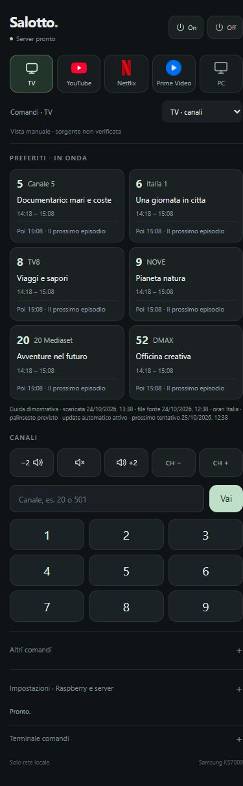
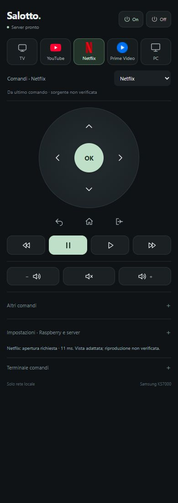
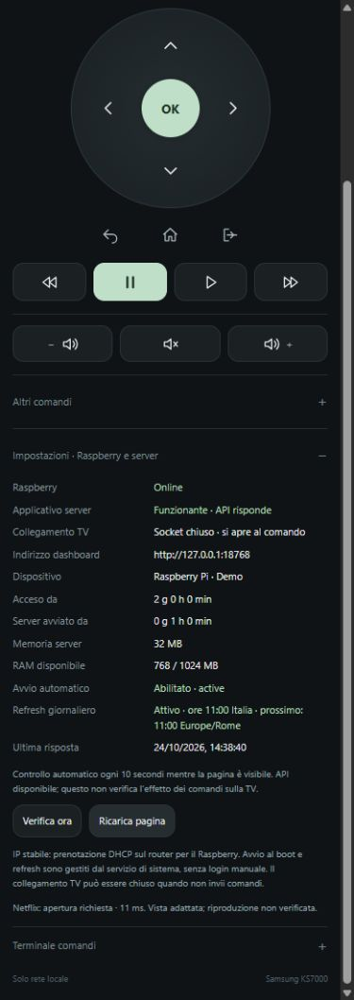

# Smart TV Remote

A compact, local web remote for Samsung Tizen TVs. Run the Python server on a
Raspberry Pi or computer, then control your TV from a phone on the same network.
The interface is in Italian and is designed for narrow mobile screens.

## Interface

These screenshots use simulated devices and example schedules. They contain no
real device identifiers, credentials, household addresses or diagnostic logs.

<p>
  
  
</p>

<details>
<summary>Device and server status</summary>



</details>

## Features

- TV antenna, YouTube, Netflix, Prime Video and PC on HDMI 1.
- Favorites with current and next programmes, channel keypad and direct entry.
- Volume in two-step increments, mute and previous/next channel on one row.
- Directional navigation and playback controls in streaming views.
- YouTube search from the phone/PC keyboard, with results opened directly in the TV app.
- Wake-on-LAN and a short Power press for standby.
- Device/server status, uptime, memory and systemd service/timer status.
- External XMLTV guide refreshed every 24 hours without opening the browser;
  failed downloads retry after 6 hours while keeping the last valid cache.
- A command timeline with request IDs and timing, plus rotating diagnostic logs.
- Experimental PC screen sharing over LAN WebSockets, with a TV browser receiver.
- Optional systemd startup at boot and daily server refresh at 11:00 Europe/Rome.

## Requirements and compatibility

Python 3.10 or newer, a Samsung TV with network remote support, and a trusted
local network. The original deployment used a Samsung UE49KS7000 (2016) and a
Raspberry Pi 3 B. Other models may differ in supported keys, app IDs, wake behavior
and source switching. HDMI 1 selection is implemented but still needs visual
confirmation on the target TV. A successful send is not a TV execution ACK.

## Run locally

Create a virtual environment and install the application dependencies:

```sh
python -m venv .venv
# Linux / Raspberry Pi
.venv/bin/python -m pip install -r requirements.txt
# Windows
.venv\Scripts\python.exe -m pip install -r requirements.txt
```

Set `TV_HOST` to **your TV's LAN address**. The address below is a documentation
example; replace it. There is no household IP or password built into the project.

Linux / Raspberry Pi:

```sh
export TV_HOST=198.51.100.20
.venv/bin/python server.py
```

Windows PowerShell:

```powershell
$env:TV_HOST = '198.51.100.20'
.\.venv\Scripts\python.exe server.py
```

Open [localhost:8765](http://127.0.0.1:8765) on the server computer. On a phone,
open `http://SERVER_LAN_IP:8765` on the same network. Allow the new remote on the
TV when prompted. The server prints its available local addresses at startup.

| Setting | Default | Purpose |
|---|---|---|
| `TV_HOST` | `127.0.0.1` | Set this to your TV's LAN address before controlling it |
| `TV_PORT` | `8002` | Samsung WebSocket port |
| `TV_CLIENT_NAME` | `Smart TV Locale` | Name displayed in the TV authorization prompt |
| `--bind` | `0.0.0.0` | HTTP bind address; use `127.0.0.1` for computer-only access |
| `--port` | `8765` | Dashboard port |

[.env.example](.env.example) documents the variables; `.env` files are **not**
automatically loaded. Original app icons are served locally from `web/assets/`.

To try the interface without a television or live device data:

```sh
python -m tools.demo
```

The isolated demonstration runs at [localhost:8766](http://127.0.0.1:8766).
All its commands, schedules and telemetry are simulated.

## Search YouTube from your device

In the YouTube or full-controls view, tap **Cerca un video sulla TV**, type with
normal phone/PC keyboard input, and press **Cerca** (or the keyboard's Search/Enter
key). The results open in the installed YouTube app on the TV. You do not need
to select its search field, configure a character grid, or move between letters.
Spaces, accents and punctuation are preserved. Queries accept up to 128 characters.

The server sends one local DIAL request to the TV's YouTube application on port
8080, with `launch=search` and a UTF-8 URL-encoded `q` parameter. It bypasses
Samsung's native IME, which YouTube's custom keyboard can ignore. The DIAL Origin
header is set to YouTube's origin; no Google account, API key, cloud control API
or additional dependency is needed. The app naturally uses YouTube's servers for
its searches. Query contents are excluded from logs and saved UI context.

**Verified on the UE49KS7000 with YouTube already open:** the user confirmed the
requested results appeared for a search sent via DIAL. The WebSocket deep-link
route opened the app but ignored the query. An empty DIAL query kept the previous
results, so focusing the dashboard input only opens your device's keyboard:
**Cerca** submits the search to the TV. There is no per-keystroke synchronization
with the TV field. Use the directional controls to select a result.

The server cannot read the TV's query/results; the interface reports that the
request was sent rather than claiming visual confirmation for every search.
Failed/uncertain requests are never retried automatically. Restart the server
after updating the files and reload the dashboard on each device.

## Install as a Raspberry Pi service

From a checkout on the Raspberry, run as your ordinary user:

```sh
TV_HOST=198.51.100.20 bash deploy/install-pi.sh
```

Replace the example TV address first. The installer creates a Python environment,
a private environment file and a system service running as your user. It enables
startup at boot and the daily 11:00 Europe/Rome refresh. No desktop login is needed.
See [deployment instructions](deploy/README.md) for paths, management and rollback.

Use a DHCP reservation on your router to keep the server's address stable.
Network configuration and SSH credentials are deliberately not included here.

## PC screen sharing (experimental)

The Raspberry remains connected by network only. The PC browser captures a screen,
window or tab and encodes low-delay H.264 video with WebCodecs in a worker; the
Raspberry forwards the fragmented MP4 packets in RAM over
WebSockets to a page opened in the TV browser. No HDMI connection, TV application
installation or video transcoding on the Raspberry is required. Images are not
written to logs or disk. Optional shared audio is compressed in the PC browser;
phone screen capture remains unsupported.
Native browser launch, receiver connection and compressed image decode/ACK were
verified on the target Samsung UE49KS7000. Synthetic capture benchmarks use the
real Raspberry and TV; physical screen-to-panel latency remains unmeasured.
The TV's Tizen 2.4/SamsungBrowser 1.1 advertises AVC/MSE but stalls during actual
append/decode tests. This browser profile therefore selects adaptive JPEG/PNG
images directly. Other receivers try AVC and fall back if initialization or
append stalls. No WebRTC is required.

For normal use, **nothing runs on the PC except its browser**:

1. Open the remote dashboard using its trusted HTTPS address, normally
   `https://RASPBERRY_LAN_IP:8766/`, in desktop Chrome or Edge.
   The HTTP dashboard also links **Condividi dal PC** to that HTTPS sharing page.
2. Click **Condividi dal PC**, then **Condividi** and choose the screen, window
   or tab in the browser dialog. The TV receiver opens automatically if it is
   not connected. The browser always asks for capture permission each session.
   To include sound, leave **Condividi anche l’audio** enabled and select the
   browser dialog's tab/system-audio option. A capture may contain video only;
   the page reports this and keeps the screen sharing running. No microphone
   permission is requested.
3. Click **Interrompi**, close the sharing tab, or use the browser's native stop
   control to finish. **Apri sulla TV** can reopen the receiver if needed.

HTTPS must be configured once on the Raspberry, and its certificate must be
trusted once on each PC. An untrusted or expired certificate is not a supported
capture setup. See the deployment guide for configuration. The TV continues to
use HTTP port **8765** and WS port **8767**; the PC uses HTTPS **8766** and WSS
**8768**. Both socket listeners share one sender/receiver session. The Raspberry
stays on the network only; no HDMI is used. A LAN HTTP origin cannot capture the
screen directly. Mobile screen capture remains unsupported by this prototype.

The optional older `python -m tools.share_screen --server http://SERVER_IP:8765`
localhost launcher remains available for deployments without HTTPS, but is not
required by the HTTPS workflow. After a service restart, reload the sharing page
and reopen the TV receiver to refresh the in-memory access key.

Default selection is **1280 × 720 maximum, 30 images/s requested**. The selector
retains 5/10/15/30/60/90/120; the video path processes at most 60 images/s and the
compatibility path at most 30. A requested value is not a throughput guarantee.
Capture is limited to the chosen size before processing. The browser still asks
for screen permission each session.

### Shared audio

**Musica e video** requests stereo AAC-LC at 128 kb/s; **Voce** requests mono at
64 kb/s, using 96 kb/s when the PC's native AAC encoder rejects 64 kb/s. These
are encoder targets, not measured wire rates. Short ADTS groups include one
preroll frame to preserve decoder overlap across independently decoded packets.
Framing and preroll add overhead. If native AAC encoding or TV decoding is
unavailable, independently decodable IMA ADPCM blocks use 24 kHz at about
194 kb/s stereo or 97 kb/s mono, including packet headers. This fallback trades
audio bandwidth for compatibility without a codec installation on the TV.
The target Tizen 2.4/SamsungBrowser 1.1 selects ADPCM immediately: the live AAC
test interrupted its browser session, while ADPCM playback with moving images
was measured and the user confirmed continuous sound from the TV speakers.

AudioWorklet captures audio into transferable sample buffers; a dedicated worker
encodes it. An older-browser ScriptProcessor fallback is available. A separate
WebSocket on the existing WS/WSS ports prevents large image writes from holding
the audio stream's application queue. The Raspberry validates and forwards
compressed packets in RAM without transcoding. Both channels share the existing
Host/Origin/key checks and trusted-LAN access model; no extra port is required.

The TV uses Web Audio rather than its unreliable video MSE path. There are at
most three unacknowledged audio packets, a bounded decode queue and a short
jitter buffer. Stale packets are discarded and codec blocks carry restart state
so a missing block cannot corrupt all later audio. Playback scheduling limits
buffer growth rather than accumulating seconds of delayed sound. These are
best-effort live streams: audio and video do not share a hardware playback clock,
and exact lip synchronization is not guaranteed. If autoplay is blocked, press
**Attiva audio** on the TV. Normal stopping closes capture, audio nodes, workers
and both transport channels. Unexpected audio failure does not stop the images.

Audio-source availability depends on browser, OS and selected capture surface.
Desktop Chrome/Edge on Windows can offer tab/system audio; a selected window
may provide video only. The page never silently substitutes microphone capture.

For **Schermo intero**, enable **Condividi audio del sistema** in the browser's
native picker as well as the page's audio checkbox. Capture explicitly requests
`suppressLocalAudioPlayback:true` with `restrictOwnAudio:false`: Chromium on
Windows can select system `loopbackWithMute`, while browser-tab capture also
requests suppressed local playback. This includes sound from other applications
when the monitor/system-audio source is selected. The browser manages restoring
local playback when its capture ends; support must be checked on the actual
browser/driver. The sender measures incoming sound separately from
TV playback so a live but silent track is reported as **nessun suono acquisito**.
If the browser's system loopback remains silent, **Scegli audio da una scheda…**
selects a separate sound source while keeping the original screen video. Its
auxiliary video is disabled, requested at at most 1 fps/320×180, and never sent
to the TV. Cancelling leaves the previous source intact; stopping sharing also
stops the auxiliary capture. Neither request can bypass the native audio choice.

### Video transport

The preferred transport is AVC baseline in fragmented MP4, encoded using
WebCodecs with realtime latency mode and a preference for hardware acceleration.
OffscreenCanvas scaling and encoding run in a worker. MediaStreamTrackProcessor
feeds transferable VideoFrames without a main-thread timer or RGBA readback on
the video path. On browsers without that processor, a video-frame callback path
is used and the controller should remain visible. Input frames are discarded
before encoding when credits run out; encoded predictive frames are never
arbitrarily dropped. The Raspberry does not transcode.

There are at most three unacknowledged network packets, two encoder input jobs,
one pending AVC sample used to calculate its duration, and up to two fragments
awaiting a grouped packet. The MP4 muxer groups at most three frames per packet;
the TV appends them to MSE, trims old buffered media and catches
up to the live edge if lag exceeds 350 ms. Packets are capped at 512 KiB. The
fallback compares pixels exactly in 64-pixel tiles and packs changed tiles into
one compressed atlas. It chooses JPEG or PNG by encoded size (PNG candidates for
tiles/flat-color screens), skips static updates, refreshes the complete image
periodically, and adapts JPEG quality to acknowledgement time. One previous RGBA
frame is retained for comparison. The canvas receiver avoids per-frame DOM layout.

The UI shows rolling packets/images received per second, bandwidth and TV ACK
round-trip time. An H.264 ACK confirms SourceBuffer append, **not physical panel
presentation**; the displayed TV buffer is additional media ahead of playback.
These values are diagnostics, not experimentally measured glass-to-glass latency.
Only one capture sender and one TV receiver are accepted. Slow receivers cause
capture-frame skipping rather than an unbounded transmission queue.

**Interrompi**, the browser capture-stop control and normal sharing-tab closure
stop capture and request receiver/browser cleanup. Managed receiver tabs use a
same-origin storage signal plus `window.close()`. The Raspberry sends a long
Return press to force TV app exit (the native browser's REST app-close endpoint
returns 404 on this TV). The API does not expose the browser's persistent tab
list: clearing/restoring saved tabs cannot be guaranteed, and browsing history,
cookies and logins are not erased. Reload both pages after a service restart.

Sharing inherits the dashboard's trusted-LAN access model: another LAN user who
can open the dashboard can obtain its current access key and join a free sharing
slot. The PC-to-Raspberry leg uses HTTPS/WSS when enabled; the legacy TV leg
uses HTTP/WS. There is no personal login or pairing code. The WebSocket checks its destination Host, browser Origin and access key.
No screen capture starts without the PC user's browser selection.

## Guide and inferred state

The guide uses Open-EPG's `italy8.xml.gz`, mapped to the six favorites. The server
refreshes it independently of browser sessions and preserves the due time across
restarts. Overdue downloads run when the server starts again. The page polls the
cache every minute and displays both download time and the source file timestamp.

The guide is a published schedule, not information read from the TV. Broadcaster
changes or a bad upstream feed can still make it inaccurate. Channel/source labels
follow commands sent through this server; other remotes can change the TV without
updating the dashboard. The view selector changes the layout only.

## Logs and local data

Runtime files are kept outside Git:

| Data | Location |
|---|---|
| TV authorization, wake configuration, UI context, EPG cache | Windows: `%LOCALAPPDATA%/SmartTVLocale/`; Linux: `~/.local/share/SmartTVLocale/` |
| Diagnostic events | `diagnostics.jsonl` in that directory; rotates near 2 MB with one previous file |
| Command history | `reports/commands.jsonl` in the checkout; currently no automatic rotation |
| Service stdout/stderr | `journalctl -u smart-tv` on systemd systems |

The browser timeline keeps its latest 200 rows; browser-only events are not saved
to the server. The server's in-memory timeline holds 300 events. Do not publish
runtime logs, token files or copied device configuration.

## Tests and diagnostics

```sh
python -m unittest discover -s tests -v
```

The tests use mocked TV transport and temporary state. They cover command
validation, two-step volume, source context, power sequences, EPG parsing/cache,
automatic daily refresh/retry, diagnostics and host health. Sharing tests use real
loopback WebSockets to exercise access checks, bounded frames, display ACKs,
slow/disconnected receivers and HTTP pages. No real TV commands are sent by this suite.

With a server running, check HTTP endpoints and rejected inputs:

```sh
python -m tools.verify_server
```

For a different dashboard URL, set `SMART_TV_BASE_URL`. Additional utilities live
in `tools/` and should be run as modules from the repository root. Some control
real hardware: `python -m tools.tv`, `python -m tools.power`,
`python -m tools.launch_app` and `python -m tools.tv_source`. Use their help/source
before running them. They are separate from automatic test discovery.

## Network security

This is a trusted-LAN remote, not an Internet-facing service. Anyone who can reach
the dashboard on your LAN can control the TV. Host/Origin checks and a per-process
browser control key protect against cross-site command requests; they are not a
personal login. Do not expose port 8765 through your router or publish TV tokens.
The Samsung connection accepts the TV's self-signed certificate.

## Project layout

```text
server.py             HTTP application and command validation
remote.py             Samsung WebSocket/REST transport
power_control.py      Wake-on-LAN and standby
view_state.py         Shared inferred UI context
epg.py                Cached XMLTV guide and refresh worker
health.py             Read-only host and service telemetry
diagnostics.py        Bounded command timeline
web/                  Mobile interface and local brand icons
deploy/               Raspberry Pi installer and systemd refresh timer
tests/                Automated tests with mocked hardware
tools/                Explicit diagnostics and hardware utilities
docs/images/          Sanitized demonstration screenshots
```

Local deployment history, caches, logs and previous bundles are excluded from Git.
Brand assets and dependency attribution are listed in
[THIRD_PARTY_NOTICES.md](THIRD_PARTY_NOTICES.md).
